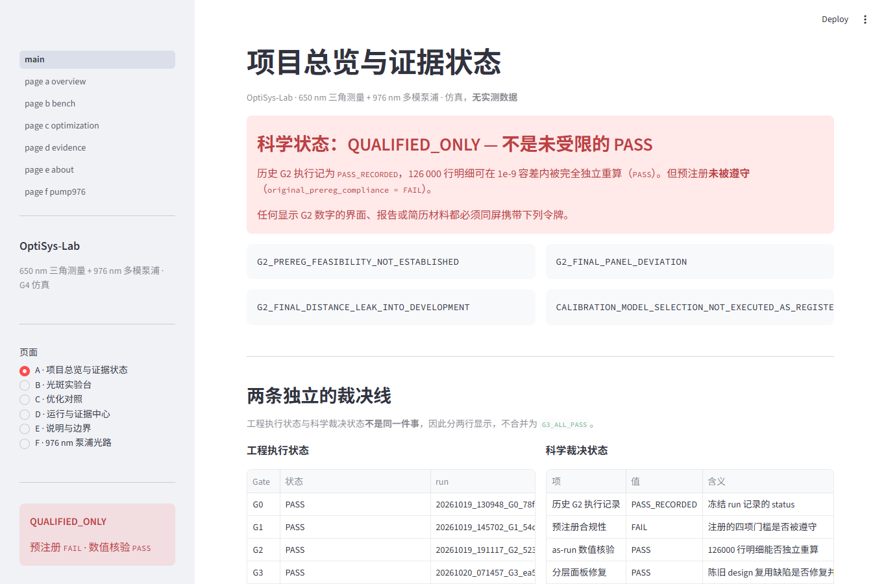
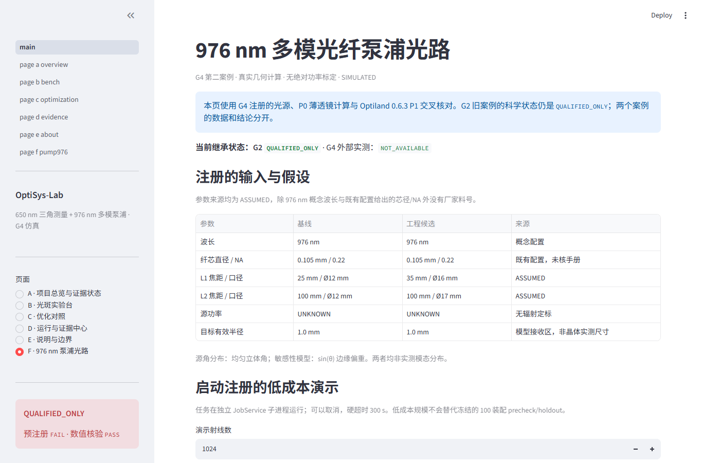

# OptiSys-Lab

**面向光电系统工程的可复现仿真平台：650 nm 激光三角测量 + 976 nm 多模光纤泵浦光路。**

面向光学工程学习者、研究者、测试工程师与开源贡献者。
把几何、成像、传感器、定位、标定与公差分析串成可测试的工程链路，
通过六页 Streamlit 界面展示结果，并保留配置、运行记录与独立复算入口。
证据来自公式、仿真和数值交叉核验；**目前无实测数据、厂家镜片或绝对功率标定**。

| 案例 | 链路与工程问题 |
|---|---|
| **650 nm 三角测量** | 几何 → 镜头/光斑 → CMOS 噪声与 ADC → 亚像素定位 → 距离标定；比较精度、像元效应与装配公差 |
| **976 nm 泵浦光路** | 多模光纤 → 双透镜几何传播 / Optiland 追迹 → 接收区几何捕获；分析高 NA、位置 trade-off 与装配扰动 |

[安装与启动](#3-分钟安装与启动) · [完整技术说明](docs/PROJECT_TECHNICAL_DETAILS.md) ·
[发布范围](docs/GITHUB_PUBLICATION.md) · [公开副本与本地核验](docs/PUBLIC_REDACTED_PUBLICATION.md)

## 界面预览

以下两张均为 **S5 阶段的历史真实浏览器截图**，随发布快照保留。
它们展示已有交互界面，不代表 S6 新截图或正式 S6 浏览器 E2E 已交付。

**项目总览与证据状态**



**976 nm 泵浦光路与几何捕获**



## 核心工程能力

- **可解释的计算链**：几何内核、像元面积积分、CMOS 噪声/ADC、三种定位器、系统标定与固定数据划分。
- **有边界的光学建模**：集成 Optiland 0.6.3；用独立傍轴、球面求交和矢量 Snell 参考核对模型。
- **公差与统计**：装配级样本、配对比较、固定种子 bootstrap；区分名义收益、低尾代价与条件成立范围。
- **工程化交付**：CLI、六页 Streamlit、受控子进程任务与 CPU 调度、取消/恢复状态、HTML 报告。
- **可靠性与追溯**：pytest、Windows/Ubuntu CI、冻结输入字节校验、SHA-256 清单、独立解压复算。

自研部分是系统链路、独立参考与验证/报告工具；Optiland 的追迹能力归属于第三方。
依赖版本与贡献边界见 [依赖和贡献说明](RELEASE_CANDIDATE_V2/DEPENDENCIES_AND_CONTRIBUTIONS.md)。

## 3 分钟安装与启动

需要 Python **3.11**。在取得源码后，进入源码根目录执行以下命令。当前为本地公开脱敏候选，正式仓库 URL 尚待选定。以下可直接用于 Windows PowerShell；
“3 分钟”指基础启动流程，首次下载依赖所需时间取决于网络。

```powershell
py -3.11 -m venv .venv
.\.venv\Scripts\python.exe -m pip install -e ".[dev,ui,optics]"
.\.venv\Scripts\python.exe scripts/verify_published_frozen_inputs.py
.\.venv\Scripts\python.exe -m streamlit run app/main.py
```

Ubuntu/macOS（Python 3.11）：

```bash
python3.11 -m venv .venv
.venv/bin/python -m pip install -e ".[dev,ui,optics]"
.venv/bin/python scripts/verify_published_frozen_inputs.py
.venv/bin/python -m streamlit run app/main.py
```

首次 clone 约需下载 34 MiB Git 对象，安装依赖还包括 Optiland 的 VTK 等传递依赖；预留约 2 GiB 空间，实际用量随平台和缓存而变。
界面包含总览、光斑实验台、优化对照、证据中心、说明与边界、976 nm 泵浦光路六页。
默认浏览发布数据；启动界面无需重跑大规模仿真。

## 两案例示范

**650 nm：低成本验证与光学烟测**

```powershell
.\.venv\Scripts\python.exe -m optisys validate --config configs/triangulation_v0.yaml
.\.venv\Scripts\python.exe repro/verify_g0.py
.\.venv\Scripts\python.exe -m optisys optics-smoke --config configs/triangulation_g2_l1.yaml
```

**976 nm：检查假设模型与装配统计**

在界面 F 页浏览 P0/P1、接收区与公差结果；以下命令只做输入校验和独立统计复算。

```powershell
.\.venv\Scripts\python.exe scripts/verify_published_frozen_inputs.py
.\.venv\Scripts\python.exe repro/verify_s6r.py --root . --output artifacts/quick/s6-science.json
.\.venv\Scripts\python.exe -m pytest -q tests/unit tests/reference
```

更完整的 CLI 和低样本 G4 示例见 [技术说明](docs/PROJECT_TECHNICAL_DETAILS.md)。
完整 G2/S6 蒙特卡洛不是首次体验的必要步骤。G0/光学烟测通常为秒级，S6 装配统计复算为秒至分钟级，取决于硬件；UI 可直接浏览已有样本。

## 测试与贡献

安装 dev/ui/optics 后，Windows 使用 `.\.venv\Scripts\python.exe -m pytest -q tests/unit tests/reference tests/ui`；Ubuntu/macOS 使用 `.venv/bin/python -m pytest -q tests/unit tests/reference tests/ui`。
云端还运行 [工作流列出的 12 个集成模块](.github/workflows/ci.yml) 和独立复算；完整历史工作区回归与可分发快照的范围不同，见 [发布记录](docs/GITHUB_PUBLICATION.md)。

欢迎通过 [贡献指南](CONTRIBUTING.md) 提交脱敏的最小复现、文档改进或可验证的功能。安全反馈状态见 [SECURITY.md](SECURITY.md)，依赖与素材许可见 [第三方归属](THIRD_PARTY_NOTICES.md)。

## 可靠性与科学边界

G0–G4、S5、S6 和 S6-R 历史裁决保持冻结。CI 结果以
[验证范围](docs/PUBLIC_REDACTED_PUBLICATION.md) 为准；
历史 S6-R 本机 **482 passed** 记录不代表当前云端结果。
发布快照省略部分完整历史树，相关测试范围见 [发布说明](docs/GITHUB_PUBLICATION.md)。

- **G2 预注册合规性：`FAIL / QUALIFIED_ONLY`**。运行完成的 `PASS` 是执行状态，不能解释为科研全通过；见 [继承裁决](docs/g3/G2_INHERITANCE_VERDICT.json)。
- **G4：`QUALIFIED`，全系统改善：`NO_SUPPORTED_IMPROVEMENT`**；S5 为假设 P1 名义条件下的 `P1_SUPPORTED_TRADEOFF`。
- **S6：名义平均收益不代表全面鲁棒**。1× 情景平均捕获收益为 **+18.05 pp**；2× stress 情景配对差的 P05 为 **−5.69 pp**，低尾有代价，汇总裁决为 `TRADEOFF_OR_NO_SUPPORTED_GAIN`。
- **证据上限**：没有任何实测数据；G4/S6 为 `SIMULATED`，实测状态为 `NOT_MEASURED` / `NOT_AVAILABLE`。无真实厂家镜片、无绝对光源功率；捕获分数不是实测光功率效率。
- **交付边界**：正式 S6 浏览器 E2E 为 `NOT_RUN_POLICY_BLOCKED`；S6 新截图与视频为 `NOT_DELIVERED`。

下图为 **S6 仿真统计图：模拟公差、假设 P1、非实测**。


## 审计与技术文档

| 入口 | 内容 |
|---|---|
| [完整技术说明](docs/PROJECT_TECHNICAL_DETAILS.md) | 原首页完整说明、模型层级、命令与依赖归属 |
| [S6-R 发布候选](RELEASE_CANDIDATE_V2/README.md) | 启动、数据、图表和交付边界 |
| [S6 独立科学复算](docs/s6r/S6R_SCIENCE_RECOMPUTATION.md) | 装配数据、配对统计与结论边界 |
| [S6-R 最终状态](docs/s6r/S6R_FINAL_STATUS.json) | 各项验证的历史结果和偏离 |
| [GitHub 发布范围](docs/GITHUB_PUBLICATION.md) | 选择性快照、脱敏与可移植 CI 测试范围 |
| [冻结输入清单](docs/g4/G4_FREEZE_HASHES.json) | G4 六项预注册输入的原始字节与 SHA-256 |
| [PUBLIC_REDACTED 审计副本](_AUDIT/PUBLIC_REDACTED_R2/OptiSysLab_S6R_PUBLIC_REDACTED_R2.zip) | 具有新标识和新校验值的公开脱敏材料 |
| [公开副本校验值](_AUDIT/PUBLIC_REDACTED_R2/OptiSysLab_S6R_PUBLIC_REDACTED_R2.sha256) | 下载后核对 SHA-256 |

本项目采用 [MIT License](LICENSE)；第三方依赖保留各自许可。

## English overview and quick start

OptiSys-Lab is a reproducible optical-engineering simulation project covering 650 nm laser triangulation and 976 nm multimode-fiber pump optics. It includes a CLI, six Streamlit pages, tolerance statistics and independent checks. Results are simulated; no hardware measurements or absolute optical-power calibration are provided. This local public-redacted candidate has not been published.

From the extracted or cloned source directory with Python 3.11, use `python -m venv .venv`, then `.venv/bin/python -m pip install -e ".[dev,ui,optics]"` and `.venv/bin/python -m streamlit run app/main.py`. On Windows replace `.venv/bin/python` with `.venv/Scripts/python.exe`. Existing examples can be browsed without rerunning large simulations. See [public-copy provenance](docs/PUBLIC_REDACTED_PUBLICATION.md) and [contribution guide](CONTRIBUTING.md).
