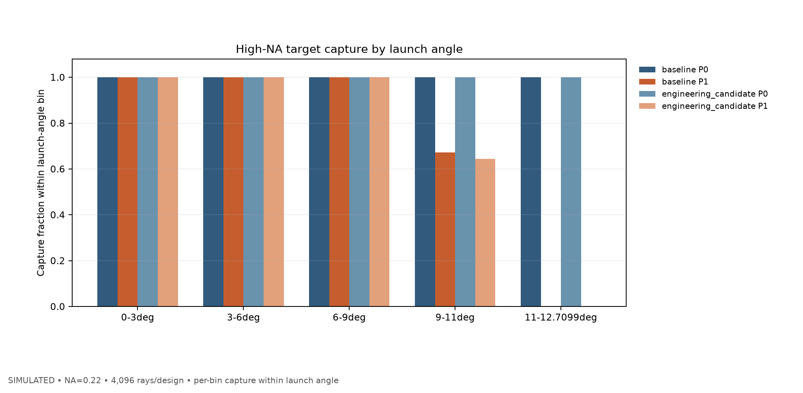
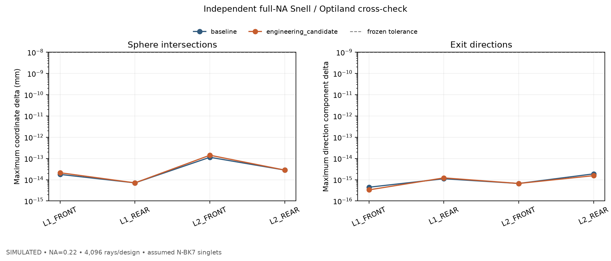
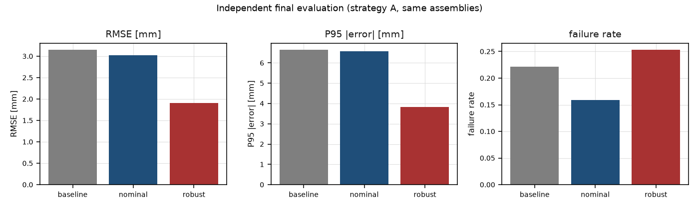

# OptiSys-Lab · local release candidate

OptiSys-Lab is a reproducible optical-system simulation platform with a 650 nm laser-triangulation main case and a 976 nm multimode-fiber pump-path second case.

**Evidence ceiling:** the project has no measured optical data. Numerical examples below are `SIMULATED`; G2 remains `QUALIFIED_ONLY`, G4 remains `QUALIFIED`, and Stage 5 cross-checks only the declared assumed P1 geometry.

## Start from a clean environment

```powershell
python -m venv .venv
..venvScriptspython.exe -m pip install -e ".[dev,ui,optics]"
..venvScriptspython.exe -m streamlit run app/main.py
```

The installation command was verified in a newly created Python 3.14.3 environment. The extras install pytest, Streamlit 1.66.0 and Optiland 0.6.3. `requirements.lock.txt` pins the observed third-party environment; no `requirements.txt` is assumed.

## Reproduce the two demonstrations

```powershell
# 650 nm triangulation demonstration: 1 assembly, 63 attempts, not comparable to G2
..venvScriptspython.exe -m optisys g3-demo --config configs/g3_demo.yaml --assemblies 1 --workers 1 --runs-dir runs/demo

# 976 nm pump-path demonstration: reduced P1/tolerance sample, correctly marked PARTIAL
..venvScriptspython.exe -m optisys pump976 --config configs/pump976_g4_l0.yaml --candidate configs/pump976_g4_l1.yaml --tolerance configs/pump976_g4_tolerance.yaml --rays 512 --assemblies 2 --timeout 180 --runs-dir runs/pump_demo
```

Both commands were executed from the clean environment. The G3 demo returned 63 rows and explicitly reported `comparable_to_g2: false`. The reduced G4 pump command returned `PARTIAL`, `G4_OPTICAL_MODEL_VERIFICATION=QUALIFIED` and `G4_EMPIRICAL_VALIDATION_STATUS=NOT_AVAILABLE`. Generate an HTML report for a run without changing a frozen run:

```powershell
..venvScriptspython.exe -m optisys report --run runs/<run_id>
```

The CLI sends G3/G4 reports to a timestamped `runs/_derived/` folder and reports `frozen_run_untouched: True`.

## What Stage 5 established

Stage 5 is a post-G4 extension, not a new mandatory gate in the original project plan.

- The independent global-coordinate sphere/Snell tracer agreed with Optiland 0.6.3 across 32,768 physical surface rows (two designs, 4,096 rays each): maximum coordinate component delta `1.42e-13 mm`, direction component delta `1.89e-15`, zero outcome mismatches.
- Under the assumed G4 P1 singlets, no high-NA ray was clipped at a lens aperture. The rays missing the assumed 1 mm circle missed the receiving region at its original axial plane. The pupil-dependent longitudinal-focus proxy is consistent with spherical aberration in this model.
- A separate equal-clear-aperture position search held the 1 mm circle at z=225 mm and changed only L2's principal plane from 125 to 135 mm. On an independent 4,096-ray holdout, source-weight capture changed from 66.09% to 87.06%; paired ray-bootstrap 95% interval: +19.73 to +22.19 percentage points. This is a nominal simulated trade-off, not assembly-tolerance or hardware validation.
- The G4 candidate's assumed L1 edge thickness is `0.158 mm`, flagged as exploratory low edge thickness. This is not a manufacturing rejection; no vendor drawing exists.







## Five-minute browser demonstration

The verified local app has six pages: project overview, optical bench, optimization comparison, evidence center, about/limits, and 976 nm pump path. Real Edge screenshots captured after the Streamlit app became idle are in `screenshot_evidence/`. A video was not delivered. See [DEMO_SCRIPT_5MIN.md](DEMO_SCRIPT_5MIN.md) and [DEMO_CAPTURE_CHECKLIST.md](DEMO_CAPTURE_CHECKLIST.md).

## Dependencies and ownership

NumPy/SciPy implement numerical utilities; Optiland provides the P1 lens trace; Streamlit provides the UI. The S5 independent sphere intersection, vector Snell reference, source-weight ledger, marginal diagnostics, position-only comparison, report pipeline and audit packaging are project-owned code. Full package license is MIT; dependency licenses are listed in the root README.

## Audit and limitations

The independent S5 audit package is at `_AUDIT/20261020_210201_S5_HNA/`. Its extracted reproduction command is `python repro/verify_s5.py`; it recomputes surface rays, angle capture, target sensitivities, focus planes, edge thickness, and the paired holdout comparison, then checks ZIP hashes and tamper rejection.

No vendor lens, measured fiber mode profile, absolute source power, real crystal dimensions, coatings/Fresnel loss, P1 assembly tolerance, Er:YAP absorption/thermal response, remote CI run, GPU test or experiment is claimed. See [reports/S5_HIGH_NA_DIAGNOSIS.md](reports/S5_HIGH_NA_DIAGNOSIS.md) and [reports/S5_OPEN_ISSUES.md](reports/S5_OPEN_ISSUES.md).

S5 GPT audit ZIP: `_AUDIT/20261020_210201_S5_HNA/OptiSysLab_S5_20261020_210201_S5_HNA_GPT_AUDIT.zip`. The SHA-256 sidecar is `AUDIT_ZIP_SHA256.txt` beside the archive.
