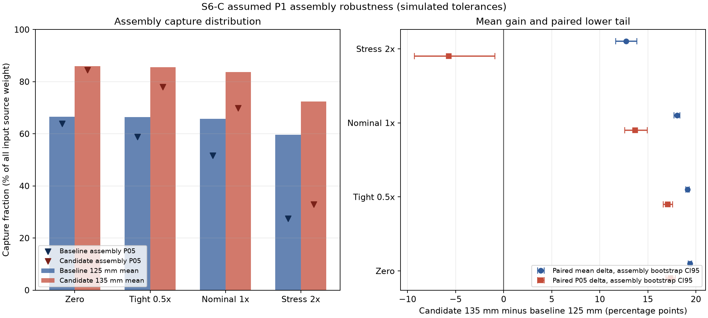

# OptiSys-Lab — 光电系统仿真与证据平台

OptiSys-Lab 将 Python 命令行、可复现运行记录、报告和本地 Streamlit 界面用于两个工程光学案例：650 nm 三角测量与 976 nm 多模光纤泵浦光路。

本文件夹是 S6-R 收尾中的发布候选。入场时的截图、浏览器验收和审计包声明已按实际文件更正。S6-C 逐装配统计、权重账本、配对关系和固定种子 bootstrap 已从原始 CSV 独立复算并与历史输出逐项核对；本机全量回归、CLI demo、AppTest、服务 smoke 和浏览器页面交互均已完成。

## 本地启动

在仓库根目录的 PowerShell 中执行。以下安装命令已在 Python 3.11.9 的全新虚拟环境中执行成功：

```powershell
py -3.11 -m venv .venv_s6r_release
.\.venv_s6r_release\Scripts\python.exe -m pip install -e ".[dev,ui,optics]"
.\.venv_s6r_release\Scripts\python.exe -m streamlit run app/main.py
```

UI 包含项目总览、光斑实验台、优化对照、运行与证据中心、说明与边界、976 nm 泵浦光路六页。关闭服务请在启动的终端按 `Ctrl+C`。

## 运行两个示例

以下命令使用小型派生运行目录，不修改冻结科学运行。650 nm demo 已以 1 个装配运行成功；976 nm demo 使用 512 rays × 2 assemblies，CLI 退出码为 0，run 自身标为 `PARTIAL`，作为缩小样本演示，不替代完整 G4 公差验证。

```powershell
.\.venv_s6r_release\Scripts\python.exe -m optisys g3-demo --config configs/g3_demo.yaml --assemblies 1 --workers 1 --runs-dir runs/_derived/s6r_20261021_0842/g3_demo
.\.venv_s6r_release\Scripts\python.exe -m optisys pump976 --config configs/pump976_g4_l0.yaml --candidate configs/pump976_g4_l1.yaml --tolerance configs/pump976_g4_tolerance.yaml --rays 512 --assemblies 2 --timeout 180 --runs-dir runs/_derived/s6r_20261021_0842/pump976
```

CLI 打印实际运行目录后，可将其传给报告命令：

```powershell
$RunDir = Get-ChildItem .\runs\_derived\s6r_20261021_0842\pump976 -Directory | Sort-Object LastWriteTime -Descending | Select-Object -First 1 -ExpandProperty FullName
.\.venv_s6r_release\Scripts\python.exe -m optisys report --run $RunDir
```

## S6 装配敏感性结果

历史 S6-C 运行记录比较假设 P1 光学系统中 L2 主平面位置 125 mm 与 135 mm，涵盖四种模拟误差情景，共 800 个 assembly；每个 assembly、每种设计追迹 1,024 条共享源光线。原始数据位于 [`evidence/s6/`](evidence/s6/)，最终图为：



- 名义 1×公差：S6-R 从 200 个完整配对 assembly 独立复算得到平均捕获差 **+18.05 个百分点**，assembly-cluster bootstrap 95% CI 为 **[+17.74, +18.34] pp**；配对 P05 差为 **+13.67 pp**，bootstrap CI 为 **[+12.60, +14.93] pp**。
- 2×压力情景：独立复算得到平均差 **+12.75 pp**，但配对 P05 差为 **−5.69 pp**，bootstrap CI 为 **[−9.28, −0.90] pp**；候选有 2 条 L2 截光射线，基线有 1 条。
- 历史最终解释为 `TRADEOFF_OR_NO_SUPPORTED_GAIN`；早期程序自动标签 `SUPPORTED_WITHIN_ASSUMED_P1_AND_TOLERANCES` 仍保留为历史记录。

四个情景均有 200 个唯一装配、1,600 条设计-装配记录，且 8,000 个历史 bootstrap 结果已用固定种子逐条重放匹配。可复核的逐情景结果、边际与配对 P05 区分、Amendment 03 时间线见 [`docs/s6r/S6R_SCIENCE_RECOMPUTATION.json`](../docs/s6r/S6R_SCIENCE_RECOMPUTATION.json)。

结论只适用于假设 P1 的 N-BK7 球面镜片、假设光纤源和模拟误差分布。它不代表实测光功率、生产良率或真实硬件验证。

## 科学范围

| 阶段 | 当前记录 | 适用范围 |
|---|---|---|
| G2 | `QUALIFIED_ONLY` | 继承历史裁决 |
| G4 | `QUALIFIED`；全系统改善为 `NO_SUPPORTED_IMPROVEMENT` | 继承历史裁决 |
| S5 | `P1_SUPPORTED_TRADEOFF` | 名义假设 P1 的单束对照，不是装配级证明 |
| S6-A | `PASS`，摘要 hash 与结果前冻结一致 | 25 个非共轴矩阵情景、10 个对抗控制；属于登记几何范围的交叉核验 |
| S6-B | `OPTIMUM_NOT_BRACKETED` | 焦面和 L2 扫描未证明全域最优 |
| S6-C | 独立复算 `PASS`；名义条件收益成立，四情景总标签 `TRADEOFF_OR_NO_SUPPORTED_GAIN` | 假设 P1 与四种登记误差情景 |

绝对源功率为 `UNKNOWN`，厂家镜片型号 `NOT_VERIFIED`，实物公差、晶体尺寸、机械行程和实验数据均未提供。物理实验状态为 `NOT_AVAILABLE`。

## 演示、测试和审计状态

本轮工程结论为 `PASS_WITH_DECLARED_DEVIATIONS`：本地软件验证和科学复算通过，媒体交付为 `PARTIAL`，因为未交付本地 S6 截图 PNG、真实录屏或远端 CI。

- 全量 pytest：`PASS`，482 passed、0 failed、0 errors、0 skipped，退出码 0，墙钟 191.27 s。
- 全新安装：`PASS`，Python 3.11.9，NumPy 2.4.6、SciPy 1.17.1、Optiland 0.6.3、Streamlit 1.66.0。
- CLI demo 与报告：`PASS_WITH_DECLARED_SCOPE`。650 nm G3 demo 退出码 0；976 nm 缩小样本 demo 退出码 0，但 run 自身标为 `PARTIAL`。两者均生成 HTML/Markdown 报告。
- 六页 AppTest：`PASS`，18 passed、0 failed，A–F 每页均无 `at.exception`。
- Streamlit 真实服务 smoke：`PASS`，端口 20274，`/_stcore/health` 返回严格 `ok`，`/` 返回 Streamlit 页面外壳，进程正常关闭。
- 浏览器 E2E：`NOT_RUN_POLICY_BLOCKED`。独立 IAB 浏览器在已核实的 `http://127.0.0.1:8508/` 显示 A/C/F，并在 C 页切换 Pareto 标签；但浏览器版本、live console/error log 和本地 PNG 未能保存，系统 Chrome 截图路径被安全策略停止，未绕过。
- 新 S6 截图：`NOT_DELIVERED`。浏览器工具未提供可写入本地 PNG 的接口；`screenshot_evidence/` 中的 A/C/F 图片和 `browser_e2e.json` 属于 S5 历史证据，不是 S6 截图。
- 演示视频：`NOT_DELIVERED`；S6-R GPT 审计 ZIP：`PASS`，以独立解压复现、篡改/缺失拒绝与同环境重建核验。ZIP 位于本机 `_AUDIT/20261021_100205_S6R/`，外部 SHA-256 文件与详细状态见 `docs/s6r/S6R_FINAL_STATUS.json`。
- 远端 CI：`NOT_RUN`；GPU：`NOT_TESTED`；实物验证：`NOT_AVAILABLE`。

五分钟展示脚本见 [DEMO_SCRIPT_5MIN.md](DEMO_SCRIPT_5MIN.md)。当前截图来源和历史记录见 [screenshot_evidence/](screenshot_evidence/)，其 S5 历史性质不会更改。

浏览器交互记录见 [`docs/s6r/S6R_BROWSER_E2E.json`](../docs/s6r/S6R_BROWSER_E2E.json)；复算结果见 [`docs/s6r/S6R_SCIENCE_RECOMPUTATION.json`](../docs/s6r/S6R_SCIENCE_RECOMPUTATION.json)。本轮测试和运行日志保存在 `artifacts/s6r/`。
