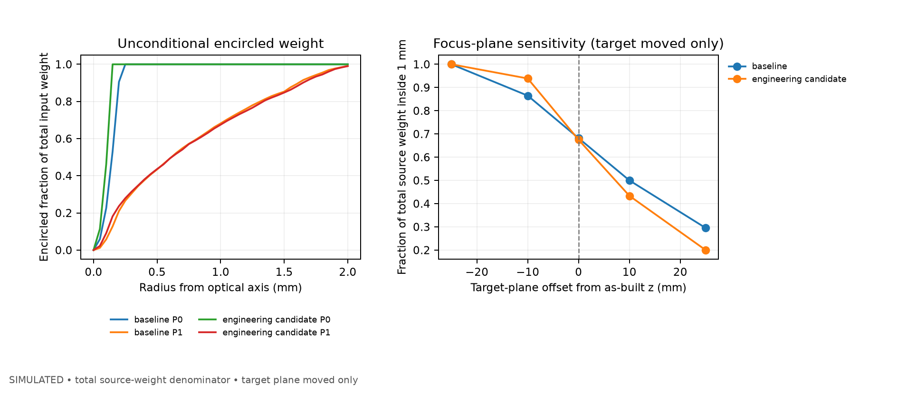

# OptiSys-Lab

## 发布入口

- [S6-R 发布候选与启动说明](../RELEASE_CANDIDATE_V2/README.md)
- [验证结果与已知限制](../docs/s6r/S6R_FINAL_STATUS.json) · [独立科学复算](../docs/s6r/S6R_SCIENCE_RECOMPUTATION.md)
- [最终审计 ZIP](../_AUDIT/PUBLIC_REDACTED_R2/OptiSysLab_S6R_PUBLIC_REDACTED_R2.zip) · [SHA-256](../_AUDIT/PUBLIC_REDACTED_R2/OptiSysLab_S6R_PUBLIC_REDACTED_R2.sha256)
- [GitHub 发布范围](../docs/GITHUB_PUBLICATION.md)

本仓库是独立的发布快照，包含源码、配置、完整测试代码、G2/G3/G4 展示数据、S5 回归样本、S6 装配统计数据、验证日志及 S5 历史展示图。历史审计材料中的“尚未上传”描述保留其生成时点；当前发布情况见上方发布范围。

本机完整回归为 **482 passed**。正式 S6 浏览器 E2E 为 `NOT_RUN_POLICY_BLOCKED`，新 S6 截图和视频为 `NOT_DELIVERED`。图中结果均来自假设光学模型，无实测验证。


**面向光电系统岗位的可复现仿真平台：激光三角测量主案例 + 976 nm 多模光纤泵浦第二案例。**

当前状态：**G0–G4 与 S5 历史裁决保持冻结 · S6-R 工程收尾 `PASS_WITH_DECLARED_DEVIATIONS` · S6-C 四情景裁决 `TRADEOFF_OR_NO_SUPPORTED_GAIN`**
模型等级 **L0（G0/G1）/ L1-approximate（G2/G3）/ P0 + 假设 P1（G4/S5/S6）**｜
证据等级 **FORMULA / SIMULATED / CROSS-CHECKED**（**无实测；G4/S6 `NOT_AVAILABLE`**）

> **G3 起请先读这两件事，它们是本项目的核心诚实性约定：**
>
> 1. G2 的 `status: PASS` 是**执行记录**，不是**预注册合规**。G2 的预注册合规性
>    判定为 `FAIL`，原因是 HC3 门限（`kernel_support ≥ 0.999`）在 as-run 口径下
>    不可达（实测 0.975–0.987），且使用了最终测试距离的开发泄漏等 5 项偏离。
>    裁决见 `docs/g3/G2_INHERITANCE_VERDICT.json`。
> 2. 本项目**没有任何实测数据**。证据上限为 `SIMULATED` / `CROSS_CHECKED`，
>    `MEASURED` 与 `VALIDATED` 不可用。所有精度数字都是仿真结果。

```text
[G0]     几何内核 → 独立向量/矩阵对照 → 边界状态码 → run provenance → 审计 ZIP

[G1]     config → 几何内核 → L0 光斑与像元积分 → CMOS 噪声/ADC
                → 三种定位器 → 系统标定 a,b → 固定 calib/val/test → 指标/图/报告

[G2]     config(schema 3.0) → Optiland 真实光线追迹 → 独立傍轴矩阵对照
         → 几何足迹 ⊛ Airy 极限 → 装配级公差 → 策略 A/B 标定
         → 名义/鲁棒预算搜索 → 冻结候选 → 2000 装配独立复评 → 配对 bootstrap

[G3]     Streamlit 六页 UI（只经 ConfigService/RunRepository/JobService/ReportService 取数）
         → 独立于 GUI 的 ReportService（schema 1/2/3）→ 受控 JobService
         → G2 继承裁决（PRE-G3-01..06 六项科学纠偏）→ 可独立复现的审计 ZIP

[G4]     976 nm 均匀面积多模射线源 → P0 双薄透镜 / P1 Optiland 双 singlet
         → 权重账本、目标平面密度、OAT、公差 holdout、第二案例 UI/报告
         → P1 高 NA 与 P0 有明显差异；无实测与绝对功率标定

[S5]     独立全球坐标球面求交 + 矢量 Snell → 4,096 射线/设计逐面核验
         → 高 NA 焦面/接收区/边缘厚度敏感性 → 同清口径位置 trade-off → 审计 ZIP

[S6/S6-R] 独立局部/世界非共轴参考 → 分离焦面与 L2 边界扫描 → 800 个装配 × 2 候选
          → 配对装配统计 / 8,000 个固定种子 bootstrap → 独立复算与最终审计包
```

## 这是什么

一个可解释、可测试、可复现的光电系统仿真平台。主案例是 650 nm 静态单点共面传感器；G4 第二案例建立 976 nm 多模光纤泵浦光路的工程几何仿真，并复用光学、评价、公差、报告与任务模块。

**不是**：商业级产品、实测标定报告、镜头设计软件、或“AI 全自动设计”。

## 快速开始

```powershell
python -m venv .venv
.venv\Scripts\activate
python -m pip install -e ".[dev,ui,optics]"

# G0：几何验证
python -m optisys validate --config configs/triangulation_v0.yaml
python -m optisys simulate --config configs/triangulation_v0.yaml

# G1：成像 / 噪声 / 定位 / 标定 / 测试（4,920 帧，4 进程约 5–6 分钟）
python -m optisys validate --config configs/triangulation_g1_l0.yaml
python -m optisys simulate --config configs/triangulation_g1_l0.yaml

# G2：真实镜头后端、公差、鲁棒设计（全量约 1 小时）
python -m optisys validate --config configs/triangulation_g2_l1.yaml
python -m optisys optics-smoke --config configs/triangulation_g2_l1.yaml   # 只跑 V4-A/V4-B
python -m optisys tolerance --config configs/triangulation_g2_l1.yaml      # 只跑公差阶段
python -m optisys g2 --config configs/triangulation_g2_l1.yaml             # 完整链路
python -m optisys g2 --config configs/triangulation_g2_l1.yaml --quick     # 烟测，固定 PARTIAL

# 发布快照的基础回归；完整历史审计回归需要原工作区档案
python -m pytest -q tests/unit tests/reference
python -m pytest -q tests/ui
python repro/verify_g0.py
python repro/verify_g1.py
python repro/verify_g2.py    # 便宜的 G2 独立复现（不含蒙特卡洛）

# G3/G4：六页交互界面（Streamlit，只读冻结 run，不触发重算）
.venv\Scripts\streamlit run app/main.py

# G3：真实小工况 demo run（12 装配 × 7 距离 × 3 候选 × 3 估计器 = 756 行，约 80 s）
.venv\Scripts\python.exe -m optisys validate --config configs/g3_demo.yaml
.venv\Scripts\python.exe -m optisys g3-demo --config configs/g3_demo.yaml --assemblies 12

# G3：独立于 GUI 的报告与审计包
.venv\Scripts\python.exe scripts/build_g3_audit_package.py --run runs/<G3 run id>
.venv\Scripts\python.exe scripts/verify_g3_audit_package.py _AUDIT/<run id>/OptiSysLab_G3_<run id>_GPT_AUDIT.zip

# G4：注册的 976 nm 泵浦光路低成本仿真演示
.venv\Scripts\python.exe -m optisys validate --config configs/pump976_g4_l0.yaml
.venv\Scripts\python.exe -m optisys pump976 --rays 512 --assemblies 2
.venv\Scripts\python.exe -m optisys report --run runs/<G4 run id>

# S5：可选的 G4 后续高 NA 核验与作品分支
.venv\Scripts\python.exe scripts/s5_run_reference.py
.venv\Scripts\python.exe scripts/s5_analyze.py
.venv\Scripts\python.exe scripts/s5_design_compare.py
.venv\Scripts\python.exe -m streamlit run app/main.py
```

每次运行新建不可覆盖的 `runs/<UTC>_<Gate>_<配置哈希>/`。
G2 文档见 `docs/g2/`：预注册 `G2_PRE_REGISTRATION.md`、假设 `G2_SCIENTIFIC_ASSUMPTIONS.md`、
判据 `G2_ACCEPTANCE_CRITERIA.md`、预算 `G2_COMPUTE_BUDGET.md`、基线 `G2_PRE_REPORT.md`。
G3 文档见 `docs/g3/`：继承裁决 `G2_INHERITANCE_VERDICT.json`、科学审计
`G2_INHERITANCE_SCIENTIFIC_AUDIT.md`、HC3 事后修订 `G2_CONSTRAINTS_AMENDMENT.md`、
验收标准 `G3_ACCEPTANCE_CRITERIA.md`、算力实测 `G3_COMPUTE_MEASURED.md`、
演示脚本 `DEMO_SCRIPT_5MIN.md`、简历主张边界 `RESUME_CLAIMS_AND_LIMITS.md`。
G4 注册条件、基线裁决、计算预算、验证结果与作品材料见 `docs/g4/`。Stage 5 是 G4 后续扩展，不是 PDF 中新增的强制 Gate；冻结判据、独立物理结果与终审见 `docs/s5/`，可展示候选见 `RELEASE_CANDIDATE/`。

## Streamlit 界面

| 页 | 名称 | 作用 |
|---|---|---|
| A | 项目总览与证据状态 | 两条裁决线**分开**显示；能力矩阵；run 选择与报告生成 |
| B | 光斑实验台 | 单帧真实追迹（`VERIFIED_RUN`）或解析预览（`FAST_PREVIEW`，标 `PREVIEW_ONLY`）；失败分类速查 |
| C | 优化对照 | 三指标同屏、Pareto 取舍、距离分组、估计器分解、A/B 标定策略、分层面板 |
| D | 运行与证据中心 | 运行清单、受控任务提交、任务详情、哈希核对、导出 |
| E | 说明与边界 | 5 分钟演示脚本、坐标/单位约定、L0 vs L1、第三方归属、开放问题 |
| F | 976 nm 泵浦光路 | 注册配置、P0/P1 结果、接收面密度、运行任务、公差样本与 G4 报告 |

**界面不会做的事**：不为失败帧填零、不隐藏失败样本、不把三个指标压成单一排名、
不把 Strategy A/B 相减、不把 G4 假设写成实测、不把 G4 结果混入 G2 结论。

## 已在本机复现的结果（含仿真）

| 层 | 指标 | 结果 |
|---|---|---|
| G0 | 解析 vs 独立 3×3 求交 + 3×4 投影 | 2.274e-13 px（阈值 1e-8） |
| G0 | 反演 vs Brent | 7.708e-16（相对） |
| G1 V1 | 像元面积积分能量守恒 | 0（40,000.000000 e vs 40,000 e） |
| G1 V1 | 独立 Gauss–Legendre 积分 | 3.44e-14 相对差 |
| G1 V1 | 亚像素误差（质心 / 1D / 2D） | 1.96e-4 / 8.03e-4 / 7.81e-5 px |
| G1 V2 | 单像元噪声（3×10k，99% CI） | 5 工况、15/15 重复通过 |
| G1 V3 | 标定参数 a 恢复 | 4.3e-6–8.3e-6 相对误差 |
| G1 端到端 | 全部有效帧 RMSE（质心 / 1D / 2D） | 0.0497 / 0.0689 / 0.0444 mm |
| G1 最终测试集 | RMSE（strong / medium / weak，2D） | 0.0080 / 0.0199 / 0.0874 mm |
| G1 失败率 | 全部尝试帧（质心 / 1D / 2D） | 2.11% / 2.32% / 6.50% |

这些数字只描述**该 L0 仿真配置**；传感器参数是设计假设，不是相机手册值，也不构成工业精度声明。完整条件、分母与置信区间见 `docs/VALIDATION_MATRIX.md`。

### G2 冻结结果（2000 装配 × 7 距离 × 3 估计器 = 42 000 行/候选）

| 候选 | 设计 (B / f / θ) | RMSE (mm) | 失败率 |
|---|---|---|---|
| baseline | 20 / 8 / 0° | 3.1481 | 22.16% |
| nominal | 15 / 11.1 / 4° | 3.0176 | 15.86% |
| robust | 34.4 / 7.27 / 4° | **1.9031** | **25.30%** |

**不要把 robust 的那行读成「最好」。** robust 用更低的 RMSE 换来了更高的失败率
（+3.14 pp）。任何把三列压成单一分数的排名都被拒绝；界面与报告始终三指标同屏。

冻结 run：`runs/20261019_191117_G2_52369787`（4 进程约 5 625 s）。
科学主张：`GAIN_SUPPORTED_WITHIN_ASSUMED_L1_MODEL`。

## G3 历史 demo 结果（12 装配，**不可与 G2 比较**）

`runs/20261020_071457_G3_ea57a83b`：756 行、77.2 s、`status PASS`、
`comparable_to_g2: false`。这是**演示链路可运行**的证据，不是 G2 结果的复现。
D4 门检查刻意断言 `max(kernel_support) < 0.999`，即 demo **继承**了 HC3 冲突而没有掩盖它。

## G4 正式运行（仿真，不是实测）

Run：`runs/20261020_133555_G4_ec3e2813_0e48`。工程状态
`PASS_WITH_DECLARED_DEVIATIONS`；光学模型 `QUALIFIED`；公差评估 `PASS`；
实测 `NOT_AVAILABLE`；科学主张 `QUALIFIED`；继承 G2 状态 `QUALIFIED_ONLY`。

| 模型 | 设计 | 几何通光至假设 1 mm target | r80 [mm] | r90 [mm] |
|---|---|---:|---:|---:|
| P0 理想薄透镜，NA 0.22 | baseline | 1.000 | 0.18693 | 0.19937 |
| P0 理想薄透镜，NA 0.22 | engineering candidate | 1.000 | 0.13352 | 0.14241 |
| P1 假设 N-BK7 singlets，NA 0.22 | baseline | 0.68188 | 0.69445 | 0.84773 |
| P1 假设 N-BK7 singlets，NA 0.22 | engineering candidate | 0.67505 | 0.69750 | 0.84341 |

正式公差为 100 装配 precheck +100 独立 holdout/设计，共 400 行，全部样本随 run/审计 ZIP。P0 paired holdout 的 r90 差为 −0.03884 mm（95% CI [−0.04147, −0.03616]），通光差 +0.00267（95% CI [+0.00158,+0.00389]）。但 P1 full-NA 下仅约 68% 加权射线落在模型 target 区，与 P0 有明显差异，因此整体不声称实际系统改善；绝对功率、W/mm² 与泵浦效率均为 UNKNOWN/NOT_EVALUABLE。

G4 审计包：`_AUDIT/20261020_133555_G4_ec3e2813_0e48/`，内容完整性、独立解压复算、篡改拒绝与 Python 3.11/3.14 ZIP 重建均 PASS；外部 ZIP 哈希见同目录 `AUDIT_ZIP_SHA256.txt`。**作品包仍为 PARTIAL**：视频与可交付的 UI 截图均 `NOT_DELIVERED`；远端 CI `NOT_RUN`。

## Stage 5（G4 后续可选扩展，不是新增 Gate）

Stage 5 对 G4 的 976 nm 假设模型做了独立高 NA 球面求交/Snell 核验，并把现象与软件演示收口。G4 正式状态、run 与审计 ZIP 未被改写。

| 核验 | 结果 |
|---|---|
| 独立 P1 逐面重放 | 2 个设计 × 4,096 条 NA 0.22 射线；32,768 条表面记录；Optiland 与独立参考最大表面坐标差 `1.42e-13 mm`、方向差 `1.89e-15`；目标结局零差异 |
| 名义高角度现象 | 9–11° 角度箱内，假设 1 mm 圆形接收区捕获 67.2%（baseline）/64.4%（G4 candidate）；11–12.7099° 均落在接收区外；没有镜片口径阻挡或追迹失败 |
| 模型内机制解释 | L2 出瞳外侧射线的轴向最近交会位置更靠前，符合纵向球差导致的边缘光线焦点前移；将接收平面按预注册网格前移 25 mm 后，本模型两方案均达到 100% 几何捕获。该位置是网格下边界，精确最佳焦点未被括定 |
| 同清口径位置 trade-off | 独立 holdout 4,096 条射线；固定 12/12 mm 清口径、同玻璃/厚度/焦距、z=225 mm / r=1 mm，只将 L2 主平面从 125 移至 135 mm（镜间距 100→110 mm）；输入权重捕获从 66.09% 到 87.06%，配对射线 bootstrap 95% 区间为 +19.73 至 +22.19 个百分点 |
| 机械筛查 | 假设 G4 candidate 的 L1 边缘厚度 `0.158 mm`，触发探索性低边厚警告；baseline L1 为 `0.542 mm`。这不是制造判定，镜片商品外径仍未知 |

这些结果只支持**当前假设 P1 几何模型**中的高 NA 球差/焦面 trade-off；未验证厂商镜片、装配公差、绝对功率、泵浦效率或 Er:YAP 吸收/热效应。bootstrap 是射线抽样区间，不是装配级公差区间。S5 报告、原始 CSV、图表与独立验证包见 `docs/s5/`、`runs/20261020_210201_S5_HNA/` 和 `_AUDIT/20261020_210201_S5_HNA/`。

最终 S5 GPT audit ZIP：`_AUDIT/20261020_210201_S5_HNA/OptiSysLab_S5_20261020_210201_S5_HNA_GPT_AUDIT.zip`；最终 SHA-256 见 ZIP 同目录的 `AUDIT_ZIP_SHA256.txt`。




## Stage 6-R（S6 收尾，不是新 Gate）

S6-C 在假设 P1 几何下比较 L2 主平面 125 mm 与 135 mm：四种登记公差情景各 200 个装配，每个装配/设计 1,024 条共享源光线。S6-R 从原始逐装配 CSV 独立重算了 1,600 条设计记录、800 个配对和全部 8,000 个 assembly-cluster bootstrap replicate；所有权重账本闭合，固定 seed 重放与历史 replicate 完全匹配。没有重跑 800 组装配或修改冻结数据。


| 情景 | 平均捕获 125 / 135 | 配对平均差，95% CI | 配对 P05 差，bootstrap CI |
|---|---:|---:|---:|
| 名义 1× | 65.69% / 83.74% | +18.05 [+17.74, +18.34] pp | +13.67 [+12.60, +14.93] pp |
| 压力 2× | 59.69% / 72.43% | +12.75 [+11.65, +13.85] pp | **−5.69 [−9.28, −0.90] pp** |

名义 1×条件估计量为 `VERIFIED_CONDITIONAL_GAIN`；四情景总裁决仍是 `TRADEOFF_OR_NO_SUPPORTED_GAIN`。压力层边际 P05 为 27.51% / 32.91%，配对 P05 为 −5.69 pp；它们是不同统计量。压力尾部基于 200 个装配并受模型假设影响，不是制造良率认证。S6-A 仅是模型内非共轴交叉验证，S6-B 的焦面与 L2 搜索均 `OPTIMUM_NOT_BRACKETED`。科学复算见 `docs/s6r/S6R_SCIENCE_RECOMPUTATION.md`。

S6-R 本机回归：482 passed、0 failed/errors/skipped；六页 AppTest 与真实 Streamlit serve smoke 通过。650 nm demo 正常；976 nm 的 512-ray × 2-assembly demo 退出码为 0，但 run 状态为 `PARTIAL`。正式浏览器 E2E 为 `NOT_RUN_POLICY_BLOCKED`；独立 IAB 中只完成 A/C/F 页面和 Pareto 标签的部分交互。S6 截图 PNG 与真实视频 `NOT_DELIVERED`。远端 CI `NOT_RUN`，GPU `NOT_TESTED`，实物验证 `NOT_AVAILABLE`。本地 GPT 审计 ZIP 已通过独立解压、复算、篡改拒绝和缺失文件拒绝；ZIP 路径与外部 SHA-256 见 `docs/s6r/S6R_FINAL_STATUS.json`。完整报告与测试日志也在 `docs/s6r/` 和 `artifacts/s6r/`。

## 科学边界

- **650 nm 主案例为 L0**：圆对称高斯光斑、像元面积积分、独立泊松/读出/暗电流噪声、线性增益、硬饱和/ADC。976 nm 案例为另行标记的 P0 + 假设 P1 几何光线模型。
- 650 nm 主案例无镜头 PSF/像差/畸变模型；S5 的 976 nm P1 仅追踪假设球面界面的几何像差，不含波前 PSF、衍射、真实散斑、PRNU/DSNU、滚动快门或真实相机/镜片料号。
- 系统标定只辨识 `a = fx·B` 与 `b = cx − fx·tanθ`；**不**声称四个几何参数可唯一辨识，也未做相机内参标定。
- 数据集按距离整体划分为 27 / 7 / 7；测试帧从不参与拟合。
- 无实测数据：`MEASURED` / `VALIDATED` 仍不可用。

## 目录

```text
src/optisys/
  geometry/      coplanar.py（解析式）、reference.py（独立向量/矩阵链）
  imaging/       spot.py（像元面积积分）、sensor.py（噪声/ADC）、roi.py
  estimators/    centroid.py、gaussian_1d.py、gaussian_2d.py、base.py
  calibration/   system.py（a,b 两参数标定与可辨识性）
  evaluation/    chain.py、splits.py、metrics.py
  gates/         g1.py（流水线）、g1_worker.py（并行帧任务）、validation.py（V1/V2）
  reports/       figures.py、figures_g1.py、report.py、report_g1.py
  qa.py          Gate 聚合（数值门 + 必需测试）
tests/           194 个测试：unit / reference / integration
configs/         triangulation_v0.yaml、triangulation_g1_l0.yaml、JSON Schema、gate_requirements.json
docs/            PROJECT_STATE、SPEC_TRACEABILITY、VALIDATION_MATRIX、DECISION_LOG、OPEN_ISSUES、SPEC_DISCREPANCIES
repro/           verify_g0.py、verify_g1.py
scripts/         run_g0、make_figures、summarize_tests、build_*_audit_package、verify_audit_package
```

> 项目根目录即仓库根目录，不嵌套 `OptiSys-Lab/` 子文件夹。见 `docs/DECISION_LOG.md` D-001。

## 坐标与公式

```text
O = (0,0,0) 相机光心；+Z 光轴；+X 物方横向
激光出射点 (B,0,0)，方向 (-sinθ, 0, cosθ)
X_L(Z) = B - Z tanθ
fx     = f_mm / p_mm
u(Z)   = cx + fx (B/Z - tanθ)
Z(u)   = fx B / (u - cx + fx tanθ)
du/dZ  = -fx B / Z²
dZ/du  = -Z² / (fx B)        # 有符号，B>0 时为负
|dZ/du|=  Z² / (fx B)        # 误差预算用幅值
```

PDF 式 (3) 把 `dZ/du` 印成正号，与式 (2) 的有符号求导不一致；幅值正确、符号缺失。详见 `docs/SPEC_DISCREPANCIES.md`（SD-001）。

## 能力与边界

| 能力 | 状态 |
|---|---|
| 共面几何、单位、独立数值验证 | 已实现（G0） |
| L0 光斑与像元面积积分 | 已实现（G1） |
| CMOS 噪声/曝光/饱和/ADC | 已实现（L0，G1） |
| 三种亚像素定位器 | 已实现（G1） |
| 系统距离标定 + 固定划分 | 已实现（G1） |
| 镜头/PSF（Optiland 0.6.3 单透镜 L1） | 已实现（G2） |
| 装配级公差 Monte Carlo / 名义与鲁棒搜索 | 已实现（G2） |
| 配对聚类 bootstrap（2000 次，种子 424242） | 已实现（G2） |
| Streamlit 界面：旧案例五页 + G4 泵浦页 | 已实现（G3/G4） |
| 版本化只读解析器（schema 1/2/3/4） | 已实现（G3/G4） |
| 受控 JobService（无 shell、可取消、重启标 ORPHANED） | 已实现（G3） |
| 独立于 GUI 的 ReportService（HTML；PDF `NOT_DELIVERED`） | 已实现（G3） |
| 可独立解压复验的审计 ZIP | 已实现（G3） |
| 976 nm 多模源 + P0 双薄透镜光线传播 | 已实现（G4，ASSUMED/SIMULATED） |
| Optiland 0.6.3 双 singlet P1 交叉核对 | G4 低 NA 限定；S5 独立全 NA 逐面核验（ASSUMED/SIMULATED） |
| 同清口径 P1 位置 trade-off | S5 nominal holdout 支持；不含装配级公差（ASSUMED/SIMULATED） |
| OAT + precheck + 独立 paired holdout | 已实现（G4 P0；扰动均 ASSUMED） |
| 消色差双胶合、Scheimpflug 倾斜、真实波前 PSF | **未实现** |
| G4 并行加速 | **未启用**（真实双透镜 profile 中 2 worker 仅 1.06×，低于 1.3×门槛；4/6 worker 更慢） |
| G4 真实器件/实测验证 | **NOT_AVAILABLE**；S5 只验证假设模型内部的高 NA 追迹一致性 |
| S5 独立高 NA 球面/Snell 参考 | **PASS（假设 P1 模型内交叉核验）**；不是实测镜片验证 |
| S5 同清口径 P1 位置 trade-off | **`P1_SUPPORTED_TRADEOFF`**（nominal holdout，射线 bootstrap） |
| GPU（CUDA） | **`NOT_TESTED`**（torch 未安装） |
| 实测验证 | **无数据**，`MEASURED` 不可用 |

## 证据与可复现

- 每次运行保存 `config_snapshot`、环境、基准、计算计划、指标、`samples.csv`、`calibration.json`、`split_manifest.json`、代表帧、图与绘图数据、HTML 报告、`provenance.json`、`run_status.json`。
- 运行目录不可覆盖；冻结 run 的 `report/evaluate` 只写入 `runs/_derived/`。
- `provenance.json` 记录源码树 SHA-256、配置哈希、Git 提交、依赖版本与种子。
- 审计包按 Gate 冻结，ZIP 外附 SHA-256，并在独立解压目录执行最小复现。

## 硬件与计算策略

实测：Ryzen 5 4600G（6C/12T）、31.41 GB RAM、GTX 1660 SUPER 6 GB。G4 profile 以 1 worker 运行为基准；S5 profile 在 2/4 worker 的 2,048-ray批次中测得 1.38×/1.51×吞吐，但正式小批量链仍选 1 worker，避免进程启动和额外常驻内存；`nvidia-smi` 可见 GPU，但 PyTorch 未安装，CUDA workload 为 `NOT_TESTED`。G0 单进程；G1 采用其历史测得的 4 个帧工作进程，BLAS/OpenMP 固定为 1。

## 第三方依赖与归属

| 依赖 | 版本 | 用途 | 许可 |
|---|---|---|---|
| NumPy | 2.4.6（S6-R clean install） | 数组与线性代数 | BSD-3-Clause |
| SciPy | 1.17.1（S6-R clean install） | 求根、优化、统计 | BSD-3-Clause |
| pandas | 3.0.6（S6-R clean install） | CSV/表格复核 | BSD-3-Clause |
| Matplotlib | 3.11.2 | 图 | PSF-based |
| PyYAML | 6.0.3 | 配置 | MIT |
| psutil | 7.2.2 | 硬件探测 | BSD-3-Clause |
| pytest | 9.1.1 | 测试 | MIT |
| Optiland | 0.6.3（可选 `optics` extra） | G2 单透镜；G4/S5 假设双 singlet 后端 | MIT |
| Streamlit | 1.66.0（可选 `ui` extra） | 六页本地交互演示 | Apache-2.0 |

本项目自研：几何内核、独立对照链、成像/噪声链、三种估计器、标定与评价、运行/审计流水线、图表与报告。第三方库的既有能力不被声称为自研。

## 许可

MIT，见 `LICENSE`。
